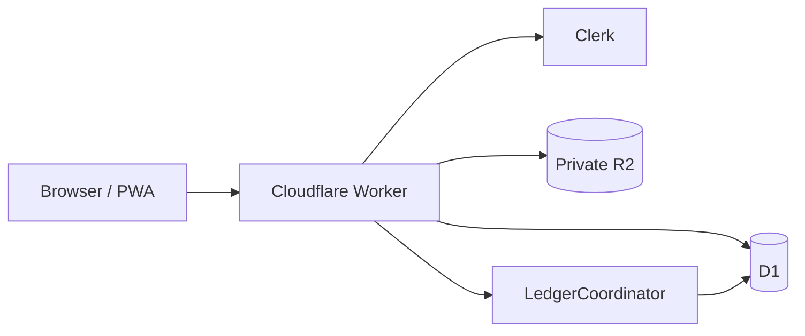

# Arsitektur

## Gambaran umum

Masjid Journal adalah aplikasi Next.js yang dibangun oleh vinext dan dijalankan sebagai Cloudflare Worker. UI, Server Components, Server Actions, dan route API berada dalam satu aplikasi. Data bisnis disimpan di D1, bukti transaksi di R2 privat, dan perubahan saldo diserialkan oleh Durable Object.

## Komponen runtime

| Komponen | Tanggung jawab |
| --- | --- |
| Next.js/vinext | Routing, rendering, Server Actions, dan route API |
| Clerk | Sign-in, sign-up, OAuth, sesi, dan identitas eksternal |
| D1 | User internal, organisasi, anggota, akun, kategori, transaksi, movement, dan audit log |
| R2 `masjid-journal-proofs` | Bukti transaksi privat |
| Durable Object `LedgerCoordinator` | Mengurutkan mutation ledger per organisasi |
| R2 response cache | Cache response vinext |

## Model identitas dan organisasi

Clerk menjadi sumber autentikasi. Setelah token valid, aplikasi mencari user D1 melalui `clerk_id`; jika belum terhubung, email Clerk yang terverifikasi dipakai untuk menghubungkan user lama. ID user D1 tetap menjadi identitas internal agar membership dan data hasil migrasi tetap utuh.

Setiap data bisnis membawa `organization_id`. Akses server harus memverifikasi membership aktif dan role sebelum membaca atau mengubah data. Hierarki role adalah `viewer < treasurer < admin < owner`.

## Model ledger

`transaction` menyimpan header transaksi. `transaction_movement` menyimpan perubahan pada satu atau dua akun beserta `balance_before`, `balance_after`, dan signed amount. Tipe transaksi:

- `income`: dana masuk ke satu akun;
- `expense`: dana keluar dari satu akun;
- `transfer`: perpindahan antar pemegang kas;
- `deposit`: pemegang kas ke rekening bank;
- `withdrawal`: rekening bank ke pemegang kas;
- `adjustment`: koreksi saldo.

Mutation saldo dibungkus `withLedgerLock(organizationId, userId, operation)`. Durable Object bernama berdasarkan organisasi memastikan operasi saldo organisasi yang sama berjalan berurutan. Perubahan transaksi, movement, saldo akun, dan audit log memakai batch D1 agar atomik.

## Bukti transaksi

Satu transaksi menyimpan satu `proof_storage_path`. Foto, termasuk HEIC/HEIF, diproses di browser menjadi WebP dengan target maksimum 1 MB. Dokumen yang didukung disimpan dalam format asal dengan batas 10 MB. Object key R2 adalah `<transactionId>.<extension>`.

R2 tetap privat. `/api/proofs/[...key]` memeriksa sesi dan membership organisasi sebelum mengalirkan objek. Gambar dan PDF ditampilkan inline; dokumen lain dikirim sebagai attachment. Penggantian bukti menghapus object lama bila ekstensi berubah, dan penghapusan transaksi membersihkan bukti terkait.

## Keamanan

- Semua halaman aplikasi memerlukan sesi Clerk yang valid.
- `authorizedParties` dibatasi ke `NEXT_PUBLIC_APP_URL` di production.
- Authorization dilakukan kembali di server; kontrol UI bukan batas keamanan.
- Query dan mutation harus dibatasi dengan organisasi aktif.
- R2 tidak memiliki public bucket URL.
- Secret hanya tersedia melalui Worker secret atau environment lokal yang diabaikan Git.
- D1 migration bersifat forward-only dan harus kompatibel dengan Worker yang sedang aktif selama rollout.

## Lokasi kode utama

| Area | Lokasi |
| --- | --- |
| Route dan halaman | `app/` |
| Komponen | `components/` |
| Server actions dan query | `lib/server/` |
| Auth dan role | `lib/auth/` |
| Koordinator ledger | `lib/ledger-coordinator.ts` |
| Schema D1 | `drizzle/schema.sqlite.ts` |
| Migrasi | `drizzle/migrations/` |
| Konfigurasi Worker | `cloudflare.config.ts`, `wrangler.jsonc` |

